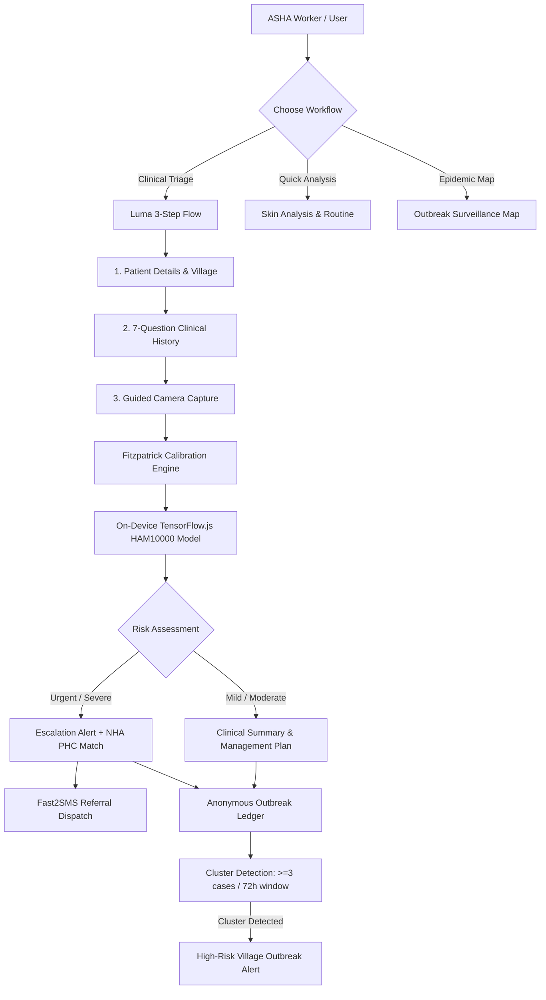

# Luma 🩺✨

> **Offline-First, Fitzpatrick-Calibrated AI Dermatology & Rural Triage System**  
> *Empowering frontline healthcare workers (ASHA / PHCs) and rural communities with 100% on-device clinical screening, multilingual voice guidance, and real-time outbreak surveillance.*

[](https://react.dev/)
[](https://vitejs.dev/)
[](https://tailwindcss.com/)
[](https://www.tensorflow.org/js)
[](https://vitest.dev/)
[](render.yaml)
[](https://web.dev/progressive-web-apps/)
[](LICENSE)

---

## 🌟 Overview

In rural India and underserved low-resource regions, access to certified dermatologists is critically scarce—with less than **1 dermatologist per 100,000 people** outside Tier-1 cities. Furthermore, most existing computer vision dermatology models suffer from significant **fair-skin training bias**, misdiagnosing or under-detecting conditions on darker skin phenotypes (Fitzpatrick Types IV–VI).

**Luma** addresses this critical gap. Built as a high-performance **Progressive Web Application (PWA)**, Luma delivers **100% on-device clinical triage and lesion screening**. It operates seamlessly without requiring internet connectivity, safeguards patient privacy by keeping all images locally in the browser, and equips Accredited Social Health Activists (ASHA) with intelligent triage tools, multilingual voice guidance, and automated Primary Health Centre (PHC) referrals.

---

## ⚡ Core Capabilities & Clinical Innovations

### 1. 🧠 Dual-Engine Hybrid Triage Architecture (Edge AI + CDSS)
- **Engine 1: Clinical Decision Support System (CDSS)**: Implements WHO-aligned syndromic decision trees to evaluate the 7-point clinical history (pruritus, household clusters, lesion duration, ABCDE changes) for high-prevalence rural dermatoses (Scabies, Tinea Corporis, Eczema, Contact Dermatitis).
- **Engine 2: On-Device Vision Classifier**: Uses quantized TensorFlow.js MobileNet models running locally via hardware-accelerated WebGL (with CPU/WASM fallback) for pigmented lesion risk stratification (Melanoma, Basal Cell Carcinoma, Actinic Keratosis).
- **Zero Cloud Exposure**: Image data is decoded into client-side volatile memory. Zero photos or patient identifiers are transmitted to external servers.

### 2. 🎯 Individual Typology Angle (ITA) & Melanin Calibration
To address the severe underrepresentation of darker skin tones in public dermatology datasets:
- **Colorimetric Sampling**: Converts epidermal RGB canvas pixels into CIELab space to extract the **Individual Typology Angle**:
  $$\text{ITA}^\circ = \arctan\left(\frac{L^* - 50}{b^*}\right) \times \frac{180}{\pi}$$
- **Dynamic Thresholding**: When Fitzpatrick Types V & VI are detected ($\text{ITA} < 10^\circ$), Luma flags potential erythema masking (where inflammation manifests as hyperpigmentation or violaceous discoloration rather than classic Caucasian pink erythema) and recalibrates diagnostic confidence intervals.
- **Ambient Illuminant Compensation**: Measures ambient color temperature and luminosity (Daylight, Open Shade, Fluorescent/Warm, Low Light), preventing false inferences when operating in dimly lit rural dwellings.

### 3. 📷 Macro & Sensitive Body Area Photo Upload
- **High-Resolution External Camera Support**: Recognizes that low-cost smartphone webcams often lack macro focus. Community health workers can take sharp macro photos using external digital cameras or phones and upload them directly into the offline pipeline.
- **Dignity & Privacy for Sensitive Lesions**: Enables patients with lesions on intimate or covered body parts to take private photos safely offline and upload them without requiring invasive live camera streaming.

### 3. 🩺 Guided Rural Clinical Triage Workflow
A streamlined, foolproof 3-step operator flow built specifically for community health workers:
1. **Patient Intake**: Fast recording of demographic data and location details.
2. **7-Question Clinical History**: Structured symptom questionnaire (lesion evolution, itch vs. pain, bleeding, previous treatments, family history).
3. **Smart Camera Capture**: Viewport lesion framing with real-time blur detection, glare checking, and lighting validation before capture.

### 4. 🚨 Red Flag & Clinical Escalation Detection
- Flags high-urgency conditions (e.g., Melanoma, Basal Cell Carcinoma, severe Actinic Keratoses) with immediate visual warnings.
- Delivers clinical protocol guidance and emergency instructions tailored for non-physician field operators.

### 5. 🏥 National Health Authority (NHA) HFR & SMS Referrals
- **PHC Resolution**: Integrated directory mapping to NHA Health Facility Registry (HFR) facilities across rural districts.
- **Automated Referral Slips**: Generates structured referral documentation containing case summaries and diagnostic risk ratings.
- **Fast2SMS Dispatch**: Instant dispatch of emergency and appointment referral SMS alerts to patients and local health officers.

### 6. 🗺️ Real-Time Contagious Outbreak Surveillance
- **Epidemiological Cluster Detection**: Built-in 72-hour sliding window algorithm detects clusters (≥ 3 cases) of contagious skin conditions (e.g., Scabies, Tinea/Ringworm, Impetigo) across village corridors.
- **Strict Anonymization**: Only village coordinates, timestamp, Fitzpatrick tone, and condition are logged—strictly zero names, contact details, or PII.

### 7. 🗣️ Multilingual Voice Guidance (Bhashini AI)
- Fully localized voice text-to-speech (TTS) and UI translations for **7 Indian languages**:
  - Hindi (हिन्दी)
  - Marathi (मराठी)
  - Bengali (বাংলা)
  - Tamil (தமிழ்)
  - Telugu (తెలుగు)
  - Gujarati (ગુજરાતી)
  - English
- Designed to overcome literacy barriers during patient consultations.

### 8. 🌿 Skincare Routine & Health Advisory Engine
- Comprehensive consumer-grade routine engine for preventative skincare and barrier repair, tailored for sensitive and tropical climate skin conditions.
- Offline record tracking powered by `localforage` / IndexedDB.

---

## 🏗️ Architecture & Diagnostic Flow



---

## 💻 Tech Stack

| Domain | Technology | Description |
|---|---|---|
| **Frontend Framework** | React 19 + Vite 8 | Ultra-fast client runtime with modern ES module builds |
| **Styling & UI** | Tailwind CSS v4 + Radix UI + Framer Motion | High-performance responsive layouts, micro-animations, and fluid transitions |
| **Icons** | Lucide React | Clean, scalable vector medical and functional iconography |
| **Machine Learning** | TensorFlow.js + MobileNet | Client-side deep learning with WebGL / WASM acceleration |
| **Offline Storage** | LocalForage (IndexedDB) | Robust client-side database caching patient history and telemetry |
| **Voice & Multilingual** | Bhashini AI / Web Speech API | Multi-language voice output across 7 regional Indian languages |
| **External Services** | NHA HFR Registry + Fast2SMS | Health facility resolution and cellular SMS notifications |
| **Testing** | Vitest + React Testing Library + JSDOM | Unit, integration, and memory leak stress testing |

---

## 📂 Project Structure

```text
Luma/
├── public/
│   ├── model/                     # Quantized TensorFlow.js HAM10000 model shards
│   │   ├── model.json
│   │   └── group1-shard*.bin
│   ├── favicon.svg
│   └── icons.svg
├── src/
│   ├── assets/                    # Static branding, images, and vectors
│   ├── components/                # Reusable UI & clinical components
│   │   ├── CameraCapture.jsx      # Lesion capture with blur/lighting check
│   │   ├── DeviceSelectionModal.jsx
│   │   ├── EscalationAlert.jsx    # Emergency clinical referral modal
│   │   ├── Layout.jsx             # Topbar, navigation, and language selector
│   │   ├── ResultsDisplay.jsx     # Clinical prediction & confidence cards
│   │   └── ui/                    # Base primitives (buttons, sliders, blur)
│   ├── contexts/
│   │   └── LanguageContext.jsx    # Multilingual state & Bhashini TTS wrapper
│   ├── lib/                       # Clinical, geographic, and messaging logic
│   │   ├── bhashini.js            # Indian language translation & voice synthesis
│   │   ├── diseaseMap.js          # Village dataset & 72h cluster detection algorithm
│   │   ├── fitzpatrick.js         # Melanin calibration & tone classification
│   │   ├── phc.js                 # NHA Health Facility Registry directory
│   │   ├── sampleLesions.js       # Offline clinical calibration benchmarks
│   │   ├── sms.js                 # Fast2SMS emergency notification client
│   │   └── utils.js               # Formatting and class merging helpers
│   ├── services/
│   │   ├── historyService.js      # LocalForage encrypted client storage
│   │   └── mlService.js           # TensorFlow.js pipeline, memory leak safeguards
│   ├── tests/                     # Vitest test suites (39 tests)
│   │   ├── CameraCapture.test.jsx
│   │   ├── LumaWorkflow.test.jsx
│   │   ├── EscalationAlert.test.jsx
│   │   ├── History.test.jsx
│   │   ├── ResultsDisplay.test.jsx
│   │   ├── SkinAnalysis.test.jsx
│   │   ├── SkincareEngine.test.jsx
│   │   ├── bhashini.test.js
│   │   ├── diseaseMap.test.js
│   │   ├── fitzpatrick.test.js
│   │   ├── historyService.test.js
│   │   ├── mlService.test.js
│   │   └── phcAndSms.test.js
│   ├── views/                     # Primary application screens
│   │   ├── LumaWorkflow.jsx     # Guided 3-step rural screening workflow
│   │   ├── DiseaseMap.jsx         # Epidemic cluster detection & map view
│   │   ├── History.jsx            # Local patient consultation history
│   │   ├── Home.jsx               # Immersive landing page & PWA installer
│   │   ├── MobileSkinAnalysis.jsx # Quick mobile camera scan interface
│   │   ├── SkinAnalysis.jsx       # Diagnostic result evaluation view
│   │   └── SkincareEngine.jsx     # Preventative skincare recommendation engine
│   ├── App.jsx                    # Routing & PWA install prompts
│   ├── index.css                  # Tailwind styles and custom design system
│   └── main.jsx                   # Application entry point
├── package.json
├── tailwind.config.js
├── vite.config.js
└── README.md
```

---

## 🚀 Getting Started

### Prerequisites
- [Node.js](https://nodejs.org/) (version **18.0.0** or higher recommended)
- `npm` or `pnpm` or `yarn`

### Installation

1. **Clone the repository**:
   ```bash
   git clone https://github.com/Ansika-Singh/Luma.git
   cd Luma
   ```

2. **Install dependencies**:
   ```bash
   npm install
   ```

3. **Start the local development server**:
   ```bash
   npm run dev
   ```
   Open [http://localhost:5173](http://localhost:5173) in your browser.

4. **Build for production**:
   ```bash
   npm run build
   ```
   The compiled static assets will be created in the `dist/` directory.

5. **Preview production build locally**:
   ```bash
   npm run preview
   ```

---

## ☁️ Render Deployment (Render Track Ready)

Luma is configured for one-click static site deployment on [Render](https://render.com) using the root `render.yaml` specification:

- **Build Command**: `npm install && npm run build`
- **Publish Directory**: `./dist`
- **Routing**: Full Single-Page Application (SPA) catch-all rewrite to `/index.html` with security headers (`X-Frame-Options`, `X-Content-Type-Options`) and PWA Service Worker caching policies.

To deploy on Render:
1. Fork or push this repository to your GitHub account.
2. In the Render Dashboard, click **New +** $\rightarrow$ **Blueprint**.
3. Connect your repository. Render automatically reads `render.yaml` and spins up the live URL.

---

## ⚡ Production Bundle Optimization & Performance

Luma employs an optimized bundle-splitting strategy configured in `vite.config.js` to ensure fast initial page loads even over low-bandwidth 2G/3G mobile networks:

- **Isolated AI Engine (`vendor-tfjs`)**: TensorFlow.js model runtimes (~870 kB) are separated into an independently cached chunk.
- **UI Framework Chunk (`vendor-react`)**: React 19, DOM, and routing dependencies (~180 kB).
- **Core Application Bundle (`index.js`)**: Highly compact application logic (~360 kB).
- **Service Worker Precaching**: Automatic offline caching of model assets, routes, and styles via `vite-plugin-pwa` with CacheFirst runtime strategy.

---

## 🧪 Testing

Luma includes a comprehensive suite of **46 automated tests across 13 test suites**, covering component rendering, Fitzpatrick skin calibrations, TensorFlow memory leak prevention (zero-tensor delta verification after 20 loops), cluster detection, Bhashini localization helpers, and IndexedDB persistence.

To run the automated test suite:

```bash
# Run all tests once
npm test

# Run tests in interactive watch mode
npm run test:watch
```

---

## 📚 Academic & Clinical References

1. **Tschandl, P., Rosendahl, C. & Kittler, H.** (2018). *The HAM10000 dataset, a large collection of multi-source dermatoscopic images of common pigmented skin lesions.* Scientific Data 5, 180161.
2. **Groh, M., et al.** (2021). *Evaluating Deep Neural Networks Trained on Clinical Images in Dermatology with the Fitzpatrick 17k Dataset.* Proceedings of the IEEE/CVF Conference on Computer Vision and Pattern Recognition (CVPR).
3. **World Health Organization.** (2020). *The global control and eradication of scabies: report of the informal consultation.* Geneva: World Health Organization.
4. **National Health Authority (NHA), Government of India.** (2023). *Ayushman Bharat Digital Mission (ABDM) Health Facility Registry (HFR) Architecture Guidelines.*
5. **Chardon, A., Cretois, I., & Hourseau, C.** (1991). *Skin colour typology and evaluation of the skin protection factor.* International Journal of Cosmetic Science, 13(4), 191-208. (Individual Typology Angle definition).

---

## 🔒 Privacy & Clinical Disclaimer

1. **Privacy By Design**: Luma is engineered to prioritize data privacy. Photographic scans are processed directly within the user's browser runtime and are **never uploaded to external cloud servers**.
2. **Clinical Decision Support**: Luma is designed as an assistive triage aid for community healthcare workers, ASHA volunteers, and educational purposes. It is **not** a replacement for qualified dermatological or histological diagnosis. Urgent conditions flagged by the system must always be referred to a certified medical officer or Primary Health Centre (PHC).

---

## 📄 License

This project is licensed under the [MIT License](LICENSE).
